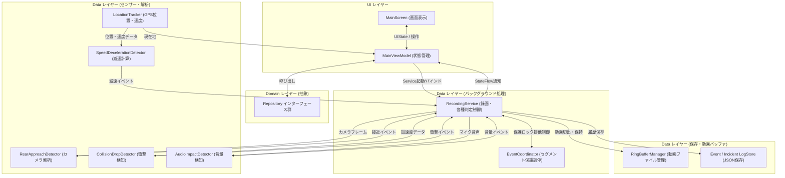

# ChariSafe アーキテクチャ仕様書 (スリム化統合版)

本書は、自転車用セーフティレコーダー「ChariSafe」のシステム全体アーキテクチャ、コンポーネント構成、データフロー、および管理データ仕様を定義する唯一の基準ドキュメント（Single Source of Truth）である。

---

## 1. システム全体設計 (MVVM + Clean Architecture)

ChariSafe は、バックグラウンドでの安定稼働と省電力性を最優先とし、必要最小限かつ凝集度の高いコンポーネント構成を採用する。

```
[ UI Layer ]
   ├── MainScreen (Compose: 常時表示 / 履歴 / ライド結果 / 設定 画面切替)
   └── MainViewModel (UI状態保持, センサー・サービス連携)
       ↕
[ Domain Layer ]
   ├── Models (AppConfig, SystemStatus, EventDetectionLog, IncidentLog, GpxPoint, RideSummary)
   └── Repositories I/F (ConfigRepository, EventLogRepository, GpxRepository, RecordingRepository)
       ↕
[ Data Layer ]
   ├── Service (RecordingService: 常時録画・検出制御, EventCoordinator: 保護調停)
   ├── Detectors (RearApproachDetector, CollisionDropDetector, AudioImpactDetector, SpeedDecelerationDetector)
   ├── Location (LocationTracker)
   └── Storage (RingBufferManager, EventDetectionLogStore, IncidentLogStore, RideSummaryStore, TraceLogger)
```

---

## 2. コアモジュール構成と責務

### 2.1 イベント種類の統一順序
アプリ全体（画面表示、集計サマリー、ログ出力等）において、イベント種類は以下の規約（**接近 ➔ 減速 ➔ 衝撃 ➔ 音量**）で完全統一する。

1. **`APPROACH`** (接近)
2. **`DECELERATION`** (減速)
3. **`COLLISION`** (衝撃)
4. **`SOUND`** (音量)

### 2.2 モジュール一覧と責務

| レイヤー / パッケージ | 主要クラス | 責務 | インターフェース (I/F) |
|---|---|---|---|
| **UI** (`ui.main`) | `MainScreen`<br>`MainViewModel` | 画面描画、ユーザー操作の受託、リアルタイム状態表示、画面状態 (`MainUiState`) の管理 | 各 Repository 経由でデータを操作 |
| **Domain - Model** (`domain.model`) | `AppConfig`<br>`SystemStatus`<br>`EventDetectionLog`<br>`IncidentLog`<br>`GpxPoint`<br>`RideSummary` | アプリ全体で扱うデータ構造の定義 | 純粋なデータモデル |
| **Domain - Repository I/F** (`domain.repository`) | `ConfigRepository`<br>`EventLogRepository`<br>`GpxRepository`<br>`RecordingRepository` | データアクセスおよびサービス操作のための抽象インターフェース群 | `data` レイヤーで具現化実装 |
| **Data - Service** (`data.service`) | `RecordingService` | **バックグラウンド中核処理**。<br>CameraXによる動画録画、リングバッファ切替、各検知器のライフサイクル制御、イベント発生時のセグメント保護発火 | - Intent (`ACTION_START_RECORDING` / `ACTION_STOP_RECORDING`)<br>- Bind (`LocalBinder`)<br>- StateFlow (`ServiceState`) |
| **Data - Service** (`data.service`) | `EventCoordinator` | イベント発生時のセグメント保護排他制御（ロック）と危険度（Severity）調停 | `RecordingService` 内でスレッドセーフに実行 |
| **Data - Detectors** (`data.camera`, `data.sensor`, `data.location`) | `RearApproachDetector`<br>`SpeedDecelerationDetector`<br>`CollisionDropDetector`<br>`AudioImpactDetector` | カメラ画像解析、GPS速度変化、加速度、マイク音声による各種危険状態のリアルタイム検知 | 検知時に各種コールバックを発火 (`onApproachDetected`, `onDecelerationDetected` 等) |
| **Data - Location** (`data.location`) | `LocationTracker` | GPS/ネットワークによる位置情報・速度の取得と GPX ポイント化 | StateFlow `currentLocation` |
| **Data - Local Storage** (`data.local`) | `RingBufferManager`<br>`EventDetectionLogStore`<br>`IncidentLogStore`<br>`RideSummaryStore` | 動画リングバッファ (`seg_*.mp4`) の削除・保護退避、イベント履歴・走行結果の JSON 永続化 | 同期/非同期 ファイル I/O |
| **Data - Trace** (`data.debug`) | `TraceLogger` | システム全体の動作追跡および不具合分析のための統一トレーサビリティログ出力 | 統合ログ出力 |

---

## 3. モジュール間データフロー



---

## 4. 管理データ一覧（データ仕様）

| データ項目名 | 型 | 単位 | 更新頻度 | 管理モジュール | 責務と取り扱いルール |
|---|---|---|---|---|---|
| `currentSpeedKmh` | `Float` | km/h | 1秒〜数秒毎 | `LocationTracker`<br>→ `MainViewModel` | 現在速度。GPS測位誤差による異常値（外れ値）はフィルタリングして伝搬すること。 |
| `deceleration` | `Float` | m/s² | GPS更新毎 | `SpeedDecelerationDetector` | 速度変化から算出される減速度。表示単位は「m/s²」で厳格に統一すること。 |
| `approachScore` | `Float` | スコア | 10fps (カメラ) | `RearApproachDetector` | カメラ解析による接近危険度スコア。 |
| `gForce` | `Float` | G | 約20ms毎 | `CollisionDropDetector` | 3軸合成加速度。衝撃閾値判定に使用。 |
| `maxAmplitude` | `Int` | 振幅 | PCM読込毎 | `AudioImpactDetector` | マイク音圧振幅値。音量衝撃閾値判定に使用。 |
| `activeCamera` | `Enum` | - | 設定変更時 | `AppConfig` | 使用カメラ (`REAR` / `FRONT`)。設定値に従ってカメラバインドを切り替えること。 |
| `EventDetectionLog` | `Class` | - | イベント成立時 | `EventLogRepositoryImpl` | 発生した検知イベントログ。連打・重複発生を防止するクールダウン制御を設けること。 |
| `IncidentLog` | `Class` | - | イベント確定時 | `EventLogRepositoryImpl` | 動画と紐付いたインシデント保護ログ。 |
| `RingBuffer Segment` | `.mp4` | ファイル | 1分毎 | `RingBufferManager` | 循環録画される1分単位のローテーション動画ファイル (`seg_YYYYMMDD_HHmmss.mp4`)。 |

---

## 5. モジュール間 I/F 一覧

| モジュール名 | 公開 I/F | 入力パラメータ | 出力 / 戻り値 | 呼び出し元 | 呼び出し先 |
|---|---|---|---|---|---|
| **`RecordingService`** | `onStartCommand` | `Intent` (Action, ActiveCamera, RingBufferMinutes, Fps 等) | `START_NOT_STICKY` | `RecordingRepositoryImpl`, `MainViewModel` | `RingBufferManager`, 各 Detector, `EventCoordinator`, `EventLogRepositoryImpl` |
| **`ConfigRepository`** | `getConfig()` / `updateConfig()` | `AppConfig` | `AppConfig` / `Unit` | `MainViewModel`, `RecordingService` | `SharedPreferences` |
| **`EventLogRepository`** | `addDetectionLog()` / `addOrUpdateIncidentLog()` | `EventDetectionLog` / `IncidentLog` | `Unit` | `RecordingService`, `MainViewModel` | `EventDetectionLogStore`, `IncidentLogStore` |
| **`GpxRepository`** | `startLogging()` / `stopLogging()` | `intervalSeconds: Long` | `Unit` | `MainViewModel` | `LocationTracker`, `GpxFileWriter` |
| **`RecordingRepository`** | `startRecording()` / `stopRecording()` | `AppConfig` | `Unit` | `MainViewModel` | `RecordingService` (Foreground Service 起動/停止) |
| **`RearApproachDetector`** | `analyze()` | `ImageProxy` (CameraX YUVフレーム) | `Unit` (内部で検知時コールバック) | CameraX `ImageAnalysis` | コールバック `onApproachDetected` |
| **`SpeedDecelerationDetector`** | `feedPoint()` | `GpxPoint` | `Unit` (内部で検知時コールバック) | `LocationTracker`, `MainViewModel` | コールバック `onDecelerationDetected` |
| **`CollisionDropDetector`** | `startListening()` / `stopListening()` | 加速度センサーイベント | `Unit` (内部で検知時コールバック) | `RecordingService` | コールバック `onCollisionOrDropDetected` |
| **`AudioImpactDetector`** | `startListening()` / `stopListening()` | マイク PCM 音声ストリーム | `Unit` (内部で検知時コールバック) | `RecordingService` | コールバック `onLoudSoundDetected` |

---

## 6. Domain Model 一覧

| モデル名 | 作成者 (インスタンス生成) | 更新者 | 保存先 | 利用者 (参照元) |
|---|---|---|---|---|
| **`AppConfig`** | `ConfigRepositoryImpl` | `ConfigRepositoryImpl` (ユーザー操作時) | SharedPreferences (`charisafe_app_config`) | `MainViewModel`, `RecordingService`, `MainScreen` |
| **`SystemStatus`** | `MainViewModel` | `MainViewModel` (位置・サービス状態更新時) | メモリ内 (`MainUiState` の一部) | `MainScreen` |
| **`EventDetectionLog`** | `RecordingService` | `EventLogRepositoryImpl` | `logs/event_detection_logs.json` | `EventLogRepositoryImpl`, `MainViewModel`, `MainScreen` |
| **`IncidentLog`** | `RecordingService` | `EventLogRepositoryImpl` | `logs/incident_logs.json` | `EventLogRepositoryImpl`, `MainViewModel`, `MainScreen` |
| **`GpxPoint`** | `LocationTracker` | - | メモリ内 / `gpx/ride_*.gpx` | `SpeedDecelerationDetector`, `MainViewModel`, `GpxFileWriter` |
| **`RideSummary`** | `MainViewModel` | `MainViewModel` | `logs/ride_summaries.json` | `MainViewModel`, `MainScreen` (RideResultScreen) |

---

## 7. Flow 一覧 (状態伝搬)

| Flow 名 | 型 | 発行・更新元 (Mutable) | 購読・参照元 (StateFlow) | 用途・保持データ |
|---|---|---|---|---|
| **`configState`** | `StateFlow<AppConfig>` | `ConfigRepositoryImpl` (`_configState`) | `MainViewModel`, `RecordingService` | 最新のアプリ設定情報 |
| **`eventDetectionLogs`** | `StateFlow<List<EventDetectionLog>>` | `EventLogRepositoryImpl` (`_eventDetectionLogs`) | `MainViewModel` | 累積イベント検知ログ一覧 |
| **`incidentLogs`** | `StateFlow<List<IncidentLog>>` | `EventLogRepositoryImpl` (`_incidentLogs`) | `MainViewModel` | 確定動画インシデント保護ログ一覧 |
| **`lastDetectionLog`** | `StateFlow<EventDetectionLog?>` | `EventLogRepositoryImpl` (`_lastDetectionLog`) | `MainViewModel` | 直近で発生した最新のイベント検知ログ |
| **`currentGpxPoint`** | `StateFlow<GpxPoint?>` | `LocationTracker` (`_currentLocation`) | `GpxRepositoryImpl`, `MainViewModel` | 最新の GPS 位置および速度情報 |
| **`recordingState`** | `StateFlow<RecordingState>` | `RecordingRepositoryImpl` (`_recordingState`) | `MainViewModel` | 録画サービスの状態 (IDLE, RECORDING, EXPORTING) |
| **`uiState`** | `StateFlow<MainUiState>` | `MainViewModel` (内部StateFlow群の `combine`) | `MainScreen` (Compose UI) | 画面描画用統合 UI ステート |

*※注: 現行アーキテクチャでは `SharedFlow` および `LiveData` は使用せず、すべて `StateFlow` に統一されている。*

---

## 8. コールバック一覧 (イベント通知)

| コールバック名 | 発火元 (Notifier) | 受信先 (Listener) | 引数 (パラメータ) | 発生タイミング・用途 |
|---|---|---|---|---|
| **`onApproachDetected`** | `RearApproachDetector` | `RecordingService` | なし (`Unit`) | カメラ解析で後方車両の接近条件が成立した時 |
| **`onDecelerationDetected`** | `SpeedDecelerationDetector` | `RecordingService` | なし (`Unit`) | GPS速度低下から急減速条件が連続成立した時 |
| **`onCollisionOrDropDetected`** | `CollisionDropDetector` | `RecordingService` | なし (`Unit`) | 加速度センサーで一定G以上の衝撃・落下を検知した時 |
| **`onLoudSoundDetected`** | `AudioImpactDetector` | `RecordingService` | なし (`Unit`) | マイク音声振幅が設定値を超えた時 |
| **`onLocationChanged`** | Android OS (`LocationManager`) | `LocationTracker` | `location: Location` | GPS / ネットワークからの位置情報更新時 |

---

## 9. Repository 実装一覧

| Interface | 実装クラス (Implementation) | 主な利用箇所 (Clients) |
|---|---|---|
| **`ConfigRepository`** | `ConfigRepositoryImpl` | `MainViewModel`, `RecordingService` |
| **`EventLogRepository`** | `EventLogRepositoryImpl` | `MainViewModel`, `RecordingService` |
| **`GpxRepository`** | `GpxRepositoryImpl` | `MainViewModel` |
| **`RecordingRepository`** | `RecordingRepositoryImpl` | `MainViewModel` |

---

## 10. Store / ストレージ仕様一覧

| Store 名 / クラス | 保存対象データ | 保存先 (パス / ファイル名) | 更新元 (Write) | 読み出し元 (Read) |
|---|---|---|---|---|
| **`EventDetectionLogStore`** | `List<EventDetectionLog>` | `logs/event_detection_logs.json` | `EventLogRepositoryImpl` | `EventLogRepositoryImpl` |
| **`IncidentLogStore`** | `List<IncidentLog>` | `logs/incident_logs.json` | `EventLogRepositoryImpl` | `EventLogRepositoryImpl` |
| **`RideSummaryStore`** | `List<RideSummary>` | `logs/ride_summaries.json` | `MainViewModel` | `MainViewModel` |
| **`RingBufferManager`** | 動画セグメント (`.mp4`) | `ringbuffer/seg_*.mp4`<br>(保護時: `recordings/`) | `RecordingService` | `RecordingService`, `RecordingRepositoryImpl` |

---

## 11. 画面状態およびサービス内部状態構造定義

### 11.1 `MainUiState` 構造定義
画面 (`MainScreen`) の表示に使用される全プロパティ構造である。

| プロパティ名 | 型 | 初期値 | 用途・説明 |
|---|---|---|---|
| `config` | `AppConfig` | `AppConfig()` | 全体設定値 |
| `status` | `SystemStatus` | `SystemStatus()` | システム状態 (速度、バッテリー、録画経過時間等) |
| `isExporting` | `Boolean` | `false` | イベント動画保存出力処理中フラグ |
| `isZipGenerating` | `Boolean` | `false` | Zip圧縮出力中フラグ |
| `savedEventFiles` | `List<File>` | `emptyList()` | 保存済み保護動画ファイル一覧 |
| `selectedEventFile` | `File?` | `null` | 再生選択中の動画ファイル |
| `eventDetectionLogs` | `List<EventDetectionLog>` | `emptyList()` | 発生した全イベント検知ログ一覧 |
| `incidentLogs` | `List<IncidentLog>` | `emptyList()` | 保護されたインシデントログ一覧 |
| `groupedTimelineItems` | `Map<String, List<TimelineItem>>` | `emptyMap()` | 日付別グルーピングタイムライン表示項目 |
| `rideSummaries` | `List<RideSummary>` | `emptyList()` | 過去の走行結果サマリー一覧 |
| `currentScreen` | `Screen` | `Screen.MAIN` | 現在表示中の画面 (MAIN, HISTORY, RIDE_RESULTS, SETTINGS) |
| `targetEventIdToHighlight` | `String?` | `null` | 履歴画面でハイライト表示する対象イベントID |
| `sessionEventCounts` | `EventCountSummary` | `EventCountSummary()` | 当該セッション内のイベント集計件数 |
| `eventCounts` | `EventCountSummary` | `EventCountSummary()` | 全期間累積のイベント集計件数 |
| `sensitivity` | `EventSensitivity` | `EventSensitivity()` | イベント判定感度設定 |
| `currentRideSummary` | `RideSummary?` | `null` | 最新の走行結果サマリー |
| `userMessage` | `String?` | `null` | 一時表示メッセージ |
| `currentApproachScore` | `Float` | `0f` | リアカメラのリアルタイム接近スコア (0〜100) |
| `currentDecelValue` | `Float` | `0f` | リアルタイム減速度 (m/s²) |
| `currentGValue` | `Float` | `0f` | リアルタイム合成加速度 (G) |
| `currentSoundAmplitude` | `Float` | `0f` | リアルタイム音圧振幅値 |

### 11.2 `ServiceState` 構造定義
バックグラウンドサービス (`RecordingService`) の動作状態構造である。

| プロパティ名 | 型 | 初期値 | 用途・説明 |
|---|---|---|---|
| `isRecording` | `Boolean` | `false` | サービスが動画リングバッファ録画中か否か |
| `targetFps` | `Int` | `10` | 設定されている目標録画フレームレート (fps) |
| `elapsedTimeSec` | `Long` | `0` | 録画セッションの継続時間 (秒) |
| `recordedBytes` | `Long` | `0` | 現在の録画ファイル/バッファの総バイト数 |
| `currentFile` | `String` | `""` | 現在書き込み中の最新動画セグメントパス |
| `errorMessage` | `String?` | `null` | サービス内部エラーメッセージ |

---

## 12. 主要ログモデル構造定義

### 12.1 `EventDetectionLog` 項目定義

| フィールド名 | 型 | 生成時初期値 | 単位 / 形式 | 役割・説明 |
|---|---|---|---|---|
| `id` | `String` | `UUID.randomUUID().toString()` | UUID文字列 | 検知ログの唯一の識別ID |
| `timestampMs` | `Long` | `System.currentTimeMillis()` | ms (エポック) | イベント発生日時 |
| `eventType` | `EventType` | - | Enum (APPROACH, DECELERATION, COLLISION, SOUND) | 発生イベント種別 |
| `speedKmh` | `Float` | - | km/h | 発生時走行速度 |
| `latitude` | `Double` | - | degree | 発生時緯度 |
| `longitude` | `Double` | - | degree | 発生時経度 |
| `sensitivityValue` | `Float` | - | 生数値 (例: 0.7, 1.5, 3.0, 5000.0) | 検出時の感度設定生数値 |
| `sensitivityLabel` | `String` | - | 表示文字列 | 画面表示用フォーマットラベル |
| `sensitivitySnapshot` | `EventSensitivity` | `EventSensitivity()` | オブジェクト | 発生時点の全検出感度のスナップショット |
| `incidentId` | `String?` | `null` | ID | 紐付けられた IncidentLog ID |
| `segmentName` | `String` | `""` | ファイル名 | 発生時に録画中だったセグメント動画ファイル名 |

### 12.2 `IncidentLog` 項目定義

| フィールド名 | 型 | 生成時初期値 | 単位 / 形式 | 役割・説明 |
|---|---|---|---|---|
| `id` | `String` | `UUID.randomUUID().toString()` | UUID文字列 | インシデント保護ログの識別ID |
| `timestampMs` | `Long` | `System.currentTimeMillis()` | ms (エポック) | 保護トリガー発生日時 |
| `triggerEventType` | `EventType` | - | Enum | 保護処理を起爆したトリガーイベント種別 |
| `triggerDetectionLogId` | `String` | - | ID | 起爆元となった EventDetectionLog ID |
| `relatedDetectionIds` | `List<String>` | `emptyList()` | IDリスト | 保護期間中に発生した全関連検知ログID |
| `highestSeverityType` | `EventType` | `triggerEventType` | Enum | 関連イベント中最高危険度のイベント種別 |
| `latitude` | `Double` | - | degree | 発生時緯度 |
| `longitude` | `Double` | - | degree | 発生時経度 |
| `videoFilePath` | `String` | `""` | パス | 代表保護動画ファイルパス |
| `coveredSegmentFiles` | `List<String>` | `emptyList()` | パスリスト | 保護対象として退避された全セグメントパス |
| `status` | `IncidentStatus` | `PENDING` | Enum (PENDING, SUCCESS, FAILED) | 保護処理ステータス |
| `failureReason` | `String?` | `null` | テキスト | 保護失敗時のエラー要因 |

---

## 13. `RecordingService` 内部責務定義

| 内部責務区分 | 具体的内容・処理方針 | 関連処理 / 関連メソッド |
|---|---|---|
| **ライフサイクル & 前景登録** | Foreground Service（`FOREGROUND_SERVICE_TYPE_CAMERA`）の起動・停止、通知表示、スリープ防止 WakeLock の維持管理。 | `onStartCommand`, `startForegroundWithNotification`, `acquireWakeLock`, `releaseWakeLock` |
| **CameraX 録画パイプライン** | バックグラウンドでの CameraX セッション構築、目標FPS（10fps）の指定、ImageAnalysis（後方接近検知）との同期実行、動画出力。 | `startRecordingPipeline`, `setupVideoCaptureAndStart`, `startVideoFileOutput`, `stopRecordingPipeline` |
| **セグメント自動ローテーション** | Coroutine タイマーにより 1 分ごとに循環動画セグメント (`seg_*.mp4`) の切り替え・作成を実行。 | `startSegmentRotationTimer`, `stopSegmentRotationTimer` |
| **センサー検知器統括** | 加速度、マイク、カメラの各 Detector の登録・監視・停止を集中制御。 | `collisionDropDetector`, `audioImpactDetector` の起動/停止 |
| **イベント検出 & 保護排他制御** | 各 Detector からのイベント通知を受信。`EventCoordinator` を使用した保護排他ロックおよび動画セグメント退避コピーの実行。 | `handleDetectedEvent`, `EventCoordinator.executeWithProtection` |
| **通知・警告音制御** | イベント発生時のビープ警告音発報、および保護完了時の OS 通知発行。 | `toneGenerator`, `showRecordingCompletionNotification` |

---

## 14. 主要データの Life-Cycle マトリクス (生成・更新・参照)

| データ構造 | 生成元 (Create) | 更新元 (Update) | 参照元 (Read) |
|---|---|---|---|
| **`AppConfig`** | `ConfigRepositoryImpl` (SharedPreferencesから読込) | `ConfigRepositoryImpl` (UI設定変更時) | `MainViewModel`, `RecordingService`, `MainScreen` |
| **`SystemStatus`** | `MainViewModel` | `MainViewModel` (位置・速度・バッテリー更新) | `MainScreen` |
| **`EventDetectionLog`** | `RecordingService` (`handleDetectedEvent`) | `EventLogRepositoryImpl` (インシデント紐付け時) | `EventLogRepositoryImpl`, `MainViewModel`, `MainScreen` |
| **`IncidentLog`** | `RecordingService` (`handleDetectedEvent`) | `RecordingService` (退避処理完了後) | `EventLogRepositoryImpl`, `MainViewModel`, `MainScreen` |
| **`GpxPoint`** | `LocationTracker` (`locationListener`) | - (不変) | `SpeedDecelerationDetector`, `GpxFileWriter`, `MainViewModel` |
| **`RideSummary`** | `MainViewModel` (`stopRecording`) | `MainViewModel` | `MainViewModel`, `MainScreen` (RideResultScreen) |
| **`ServiceState`** | `RecordingService` | `RecordingService` (`_serviceState.value`) | `RecordingService` (Binder経由), `RecordingRepositoryImpl` |
| **`RingBuffer Segment`** | `RingBufferManager` | CameraX VideoCapture | `RingBufferManager`, `RecordingRepositoryImpl` |

---

## 15. `MainViewModel` 内部責務定義

| 内部責務区分 | 具体的内容 | 関連メソッド / プロパティ |
|---|---|---|
| **画面遷移 & ハイライト管理** | ナビゲーション画面の切り替え、通知タップ時のイベントハイライト対象IDの管理。 | `setScreen()`, `setTargetEventIdToHighlight()` |
| **アプリ設定の同期管理** | 設定変更の受託と `ConfigRepository` 経由での永続化。 | `updateActiveCamera()`, `updateFps()`, `updateGpsInterval()`, `updateRingBuffer()`, `updateSensitivity()` |
| **録画セッション制御** | 録画開始・停止指示、GPSログ取得停止、`RideSummary`（走行結果サマリー）の自動計算。 | `startRecording()`, `stopRecording()`, `calculateHaversineDistance()` |
| **走行データ・永続化管理** | イベントログ・インシデントログ・過去サマリーの読み込み・削除処理。 | `loadExistingEvents()`, `loadRideSummaries()`, `deleteRideSummary()`, `deleteCurrentRide()` |
| **データ出力 & 共有処理** | イベント動画・ログ・GPXファイルのZip圧縮出力およびOS共有インテントの発行。 | `createAndShareZip()`, `shareAllData()`, `shareLogsOnly()`, `shareVideosOnly()` |
| **`MainUiState` 合成処理** | リポジトリ層・位置情報・サービス状態を `combine` で合成し単一の `uiState` に集約。 | `uiState` (StateFlow combine 定義) |

---

## 16. `EventCoordinator` 内部責務定義

| 内部責務区分 | 具体的内容 | 関連メソッド / フィールド |
|---|---|---|
| **排他保護ロック制御** | セグメント保護（コピー）処理実行中の重複・割り込み実行を AtomicBoolean で調停。 | `isProtectingLock` (`AtomicBoolean`), `isLocked()`, `executeWithProtection()` |
| **関連イベントの集約** | 保護期間中に連続発生した全検知ログIDを同一インシデント候補として追跡集約。 | `activeRelatedDetectionIds`, `startIncidentSession()`, `recordDetectionDuringProtection()` |
| **最高危険度 (Severity) 調停** | 複数の異種イベントが短時間で重なった際、最上位の危険度を判定。(衝撃4 > 減速3 > 音量2 > 接近1) | `activeHighestSeverityType`, `getHigherSeverity()`, `getAndClearActiveIncidentData()` |

---

## 17. Repository 公開 API 仕様一覧

| インターフェース | メソッド名 | 引数 (Inputs) | 戻り値 (Outputs) | 主な役割 |
|---|---|---|---|---|
| **`ConfigRepository`** | `getConfig()` | なし | `AppConfig` | メモリ上の最新設定を取得 |
| | `updateConfig()` | `config: AppConfig` | `Unit` | 設定の更新と SharedPreferences 永続化 |
| **`EventLogRepository`** | `addDetectionLog()` | `log: EventDetectionLog` | `Unit` | 検知ログの追加と JSON 永続化 |
| | `addOrUpdateIncidentLog()` | `incident: IncidentLog` | `Unit` | インシデント保護ログの保存・更新 |
| | `reload()` | なし | `Unit` | ディスク JSON からログを再読み込み |
| | `clearAll()` | なし | `Unit` | 全ログデータを消去 |
| **`GpxRepository`** | `startLogging()` | `intervalSeconds: Long` | `Unit` | 位置追跡および GPX ファイル書き込み開始 |
| | `stopLogging()` | なし | `Unit` | GPX 書き込み停止 |
| | `getActiveGpxFilePath()` | なし | `String?` | 記録中の GPX ファイル絶対パスの取得 |
| | `clearAll()` | なし | `Unit` | GPX ファイル群の全消去 |
| **`RecordingRepository`** | `startRecording()` | `config: AppConfig` | `Unit` | `RecordingService` の Foreground 起動 |
| | `stopRecording()` | なし | `Unit` | `RecordingService` の停止 |

---

## 18. 永続化 JSON スキーマ定義

### 18.1 イベント検知ログ (`logs/event_detection_logs.json`)
```json
[
  {
    "id": "c3b8a1d2-...",
    "timestampMs": 1761450000000,
    "eventType": "APPROACH",
    "speedKmh": 22.5,
    "latitude": 35.4503,
    "longitude": 139.3929,
    "sensitivityValue": 0.7,
    "sensitivityLabel": "感度: 70%",
    "incidentId": "inc_9982...",
    "segmentName": "seg_20261026_120000.mp4"
  }
]
```

### 18.2 インシデント保護ログ (`logs/incident_logs.json`)
```json
[
  {
    "id": "inc_9982...",
    "timestampMs": 1761450000000,
    "triggerEventType": "COLLISION",
    "triggerDetectionLogId": "c3b8a1d2-...",
    "relatedDetectionIds": ["c3b8a1d2-...", "d4c9b2e3-..."],
    "highestSeverityType": "COLLISION",
    "latitude": 35.4503,
    "longitude": 139.3929,
    "videoFilePath": "/storage/.../recordings/seg_20261026_120000.mp4",
    "status": "SUCCESS",
    "failureReason": ""
  }
]
```

### 18.3 走行結果サマリー (`logs/ride_summaries.json`)
```json
[
  {
    "startTimeMs": 1761446400000,
    "endTimeMs": 1761450000000,
    "movingTimeSec": 3200,
    "stoppedTimeSec": 400,
    "totalDistanceKm": 15.2,
    "averageSpeedKmh": 17.1,
    "maxSpeedKmh": 32.4,
    "eventCounts": {
      "decelerationCount": 2,
      "approachCount": 5,
      "collisionCount": 0,
      "soundCount": 1
    },
    "decelerationPerKm": 0.13,
    "decelerationPerHour": 2.25,
    "approachPerKm": 0.33,
    "approachPerHour": 5.62,
    "collisionPerKm": 0.0,
    "collisionPerHour": 0.0,
    "soundPerKm": 0.06,
    "soundPerHour": 1.12
  }
]
```

---

## 19. Detector アルゴリズム・入出力・内部パラメータ一覧

| Detector クラス | 入力データ (Input) | 内部アルゴリズム / 判定条件 | 閾値・内部パラメータ | 出力 / コールバック |
|---|---|---|---|---|
| **`RearApproachDetector`** | CameraX `ImageProxy`<br>(YUV_420_888) | 中央 ROI (X:30%-70%, Y:40%-80%) 内の高輝度ピクセル比率 & 拡大率から接近スコアを計算。夜間輝度フィルタ適用。 | - 高輝度ピクセル閾値: `>= 200`<br>- 夜間輝度上限: `<= 240.0`<br>- 連続判定数: `>= 4 フレーム`<br>- 動的スコア閾値: `25.0 + (感度 * 45.0)` | `onApproachDetected` |
| **`SpeedDecelerationDetector`** | `GpxPoint`<br>(速度 km/h, 時間 ms) | 速度を m/s に換算後、EMA平滑化 (α=0.35)。時間差分から減速度 `(v_prev - v_curr) / dt` [m/s²] を計算。 | - 平滑化係数: `0.35`<br>- 減速閾値: `1.0 〜 4.0 m/s²`<br>- 連続超過数: `>= 2 回` | `onDecelerationDetected` |
| **`CollisionDropDetector`** | 加速度 `SensorEvent`<br>(TYPE_ACCELEROMETER) | 3軸合成加速度 `sqrt(x²+y²+z²)` を計算し重力加速度 (9.81 m/s²) で割って G換算。 | - 衝撃判定閾値: `>= 3.0 G`<br>- 重力加速度: `9.81 m/s²` | `onCollisionOrDropDetected` |
| **`AudioImpactDetector`** | マイク PCM 16bit 音声<br>(`AudioRecord`, 8kHz) | ShortArrayバッファの振幅絶対値の最大値 `maxAmplitude` を検出。接近警告音鳴動中はミュート。 | - サンプリングレート: `8000 Hz`<br>- 設定振幅閾値: `1000 〜 32767`<br>- 一時ミュートフラグ: `isMuted` | `onLoudSoundDetected` |

---

## 20. システム全体のデータ単位変換仕様一覧

第三者がアルゴリズムや表示ロジックを正確に再構築するための変換規則である。

| 変換前データと単位 | 変換後データと単位 | 変換数式 / ロジック | 適用コンポーネント |
|---|---|---|---|
| GPS生速度 (`m/s`) | 時速 (`km/h`) | `speed_kmh = speed_ms * 3.6f` | `LocationTracker` |
| 時速 (`km/h`) | 秒速 (`m/s`) | `speed_ms = speed_kmh / 3.6f` | `SpeedDecelerationDetector` |
| 速度変化 (`m/s`) / 時間差 (`s`) | 減速度 (`m/s²`) | `decel = (v_prev_ms - v_curr_ms) / dt_sec` | `SpeedDecelerationDetector` |
| 3軸加速度 (`m/s²`) | 重力加速度倍率 (`G`) | `g_force = sqrt(x² + y² + z²) / 9.81f` | `CollisionDropDetector` |
| PCM 短整数 (`short`) | 振幅絶対値 (`Int`) | `amplitude = abs(pcm_short_value)` | `AudioImpactDetector` |
| ミリ秒 (`ms`) | 秒 (`sec`) | `dt_sec = (time_curr_ms - time_prev_ms) / 1000f` | `SpeedDecelerationDetector` |
| 2点の緯度経度 (`degree`) | 距離 (`km`) | Haversine Formula (球面三角法公式) | `MainViewModel` (`calculateHaversineDistance`) |
