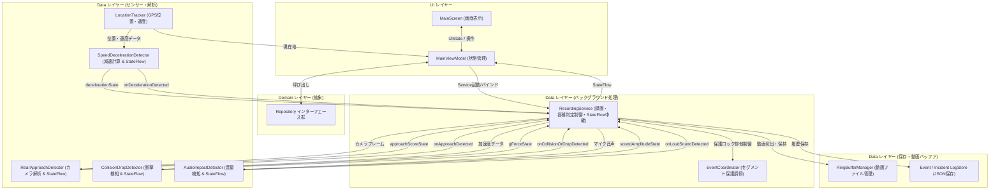

# ChariSafe アーキテクチャ仕様書 (スリム化統合版)

本書は、自転車用セーフティレコーダー「ChariSafe」のシステム全体アーキテクチャ、コンポーネント構成、データフロー、および管理データ仕様を定義する唯一の基準ドキュメント（Single Source of Truth）である。

---

## 1. システム全体設計 (MVVM + Clean Architecture)

ChariSafe は、バックグラウンドでの安定稼働と省電力性を最優先とし、必要最小限かつ凝集度の高いコンポーネント構成を採用する。

```
[ UI Layer ]
   ├── MainScreen (Compose: 常時表示 / 履歴 / ライド結果 / 設定 画面切替)
   └── MainViewModel (UI状態保持, センサー・サービス連携)
       ↕ (Realtime StateFlows)
[ Domain Layer ]
   ├── Models (AppConfig, SystemStatus, EventDetectionLog, IncidentLog, GpxPoint, RideSummary)
   └── Repositories I/F (ConfigRepository, EventLogRepository, GpxRepository, RecordingRepository)
       ↕
[ Data Layer ]
   ├── Service (RecordingService: 常時録画・検出制御, EventCoordinator: 保護調停)
   ├── Detectors (RearApproachDetector, CollisionDropDetector, AudioImpactDetector, SpeedDecelerationDetector)
   ├── Location (LocationTracker)
   └── Storage (RingBufferManager, EventDetectionLogStore, IncidentLogStore, RideSummaryStore, TraceLogger)
```

---

## 2. コアモジュール構成と責務

### 2.1 イベント種類の統一順序
アプリ全体（画面表示、集計サマリー、ログ出力等）において、イベント種類は以下の規約（**接近 ➔ 減速 ➔ 衝撃 ➔ 音量**）で完全統一する。

1. **`APPROACH`** (接近)
2. **`DECELERATION`** (減速)
3. **`COLLISION`** (衝撃)
4. **`SOUND`** (音量)

### 2.2 モジュール一覧と責務

| レイヤー / パッケージ | 主要クラス | 責務 | インターフェース (I/F) |
|---|---|---|---|
| **UI** (`ui.main`) | `MainScreen`<br>`MainViewModel` | 画面描画、ユーザー操作の受託、リアルタイム状態表示、画面状態 (`MainUiState`) の管理 | 各 Repository 経由でデータを操作。各 Detector のリアルタイム StateFlow を直結 |
| **Domain - Model** (`domain.model`) | `AppConfig`<br>`SystemStatus`<br>`EventDetectionLog`<br>`IncidentLog`<br>`GpxPoint`<br>`RideSummary` | アプリ全体で扱うデータ構造の定義 | 純粋なデータモデル |
| **Domain - Repository I/F** (`domain.repository`) | `ConfigRepository`<br>`EventLogRepository`<br>`GpxRepository`<br>`RecordingRepository` | データアクセスおよびサービス操作のための抽象インターフェース群 | `data` レイヤーで具現化実装 |
| **Data - Service** (`data.service`) | `RecordingService` | **バックグラウンド中核処理**。<br>CameraXによる動画録画、リングバッファ切替、各検知器のライフサイクル制御、リアルタイム StateFlow の中継、イベント発生時のセグメント保護発火 | - Intent (`ACTION_START_RECORDING` / `ACTION_STOP_RECORDING`)<br>- Bind (`LocalBinder`)<br>- StateFlow (`ServiceState` & リアルタイム各数値) |
| **Data - Detectors** (`data.camera`, `data.sensor`, `data.location`) | `RearApproachDetector`<br>`SpeedDecelerationDetector`<br>`CollisionDropDetector`<br>`AudioImpactDetector` | カメラ画像解析、GPS速度変化、加速度、マイク音声によるリアルタイム危険検知。**常時リアルタイム評価値を StateFlow として公開** | 検知時にコールバック発火。<br>常時リアルタイム値を StateFlow でストリーミング発行 |
| **Data - Location** (`data.location`) | `LocationTracker` | GPS/ネットワークによる位置情報・速度の取得と GPX ポイント化 | StateFlow `currentLocation` |
| **Data - Local Storage** (`data.local`) | `RingBufferManager`<br>`EventDetectionLogStore`<br>`IncidentLogStore`<br>`RideSummaryStore` | 動画リングバッファ (`seg_*.mp4`) の削除・保護退避、イベント履歴・走行結果の JSON 永続化 | 同期/非同期 ファイル I/O |
| **Data - Trace** (`data.debug`) | `TraceLogger` | システム全体の動作追跡および不具合分析のための統一トレーサビリティログ出力 | 統合ログ出力 |

---

## 3. モジュール間データフロー



---

## 4. 管理データ一覧（データ仕様）

| データ項目名 | 型 | 単位 | 更新頻度 | 管理モジュール | 責務と取り扱いルール |
|---|---|---|---|---|---|
| `currentSpeedKmh` | `Float` | km/h | 1秒〜数秒毎 | `LocationTracker`<br>→ `MainViewModel` | 現在速度。GPS測位誤差による異常値（外れ値）はフィルタリングして伝搬すること。 |
| `deceleration` | `Float` | m/s² | GPS更新毎 | `SpeedDecelerationDetector` | 速度変化から算出されるリアルタイム減速度 (`decelerationState`)。表示単位は「m/s²」で厳格に統一すること。 |
| `approachScore` | `Float` | スコア | 10fps (カメラ) | `RearApproachDetector` | カメラ解析によるリアルタイム接近危険度スコア (`approachScoreState`)。 |
| `gForce` | `Float` | G | 約20ms毎 | `CollisionDropDetector` | 3軸合成加速度 (`gForceState`)。衝撃リアルタイム表示および閾値判定に使用。 |
| `maxAmplitude` | `Int` | 振幅 | PCM読込毎 | `AudioImpactDetector` | マイク音圧振幅リアルタイム値 (`soundAmplitudeState`)。音量リアルタイム表示および閾値判定に使用。 |
| `activeCamera` | `Enum` | - | 設定変更時 | `AppConfig` | 使用カメラ (`REAR` / `FRONT`)。設定値に従ってカメラバインドを切り替えること。 |
| `EventDetectionLog` | `Class` | - | イベント成立時 | `EventLogRepositoryImpl` | 発生した検知イベントログ。 |
| `IncidentLog` | `Class` | - | イベント確定時 | `EventLogRepositoryImpl` | 動画と紐付いたインシデント保護ログ。 |
| `RingBuffer Segment` | `.mp4` | ファイル | 1分毎 | `RingBufferManager` | 循環録画される1分単位のローテーション動画ファイル (`seg_YYYYMMDD_HHmmss.mp4`)。 |

---

## 5. 「リアルタイム表示」と「イベント判定」のデータ分離仕様

「常時表示（リアルタイムフィードバック）」と「イベント判定（トリガー記録）」の混同を防ぐためのデータ分離設計仕様である。

| 機能種別 | ① リアルタイム StateFlow 値 (生データ) | ② イベント発火閾値 (トリガー条件)                                                              | ③ UI 表示値 (`MainUiState`) | ④ イベントログ保存値 (`EventDetectionLog`) |
|---|---|------------------------------------------------------------------------------------------------|---|---|
| **接近 (`APPROACH`)** | `approachScoreState`<br>- カメラフレーム毎の接近スコア<br>- 範囲: `0.0 〜 20.0` | **動的スコア閾値**: スライダー設定値 `0.0 〜 20.0` | `currentApproachScore`<br>- 常時画面の接近バー<br>- リアルタイムスコア (`0〜20`) | - `detectedValue`: 実測スコア (例: `2.85`)<br>- `thresholdValue`: 設定閾値 (例: `1.20`)<br>- `displayLabel`: `"2.85 / 1.20"` |
| **減速 (`DECELERATION`)** | `decelerationState`<br>- 現在のリアルタイム減速度<br>- 単位: `m/s²` (0.0〜5.0) | **減速閾値**: `1.0 〜 4.0 m/s²` | `currentDecelValue`<br>- 常時画面の減速バー<br>- リアルタイム減速度 (`m/s²`) | - `detectedValue`: 実測減速度 (例: `1.34`)<br>- `thresholdValue`: 設定閾値 (例: `1.20`)<br>- `displayLabel`: `"1.34 / 1.20 m/s²"` |
| **衝撃 (`COLLISION`)** | `gForceState`<br>- 3軸合成重力加速度<br>- 単位: `G` (1.0G〜10.0G+) | **衝撃閾値**: `>= 3.0 G` | `currentGValue`<br>- 常時画面の衝撃バー<br>- リアルタイム合成加速度 (`G`) | - `detectedValue`: 実測G値 (例: `4.21`)<br>- `thresholdValue`: 設定閾値 (例: `3.50`)<br>- `displayLabel`: `"4.21 / 3.50 G"` |
| **音量 (`SOUND`)** | `soundAmplitudeState`<br>- マイク音圧の正規化振幅<br>- 範囲: `0.0 〜 1.0` | **振幅閾値**: `0.1 〜 2.0` (デフォルト: 0.7) | `currentSoundAmplitude`<br>- 常時画面の音量バー<br>- リアルタイム振幅値 (`0.0〜1.0`) | - `detectedValue`: 実測振幅 (例: `0.82`)<br>- `thresholdValue`: 設定閾値 (例: `0.70`)<br>- `displayLabel`: `"0.82 / 0.70"` |

---

## 6. モジュール間 I/F 一覧

| モジュール名 | 公開 I/F | 入力パラメータ | 出力 / 戻り値 | 呼び出し元 | 呼び出し先 |
|---|---|---|---|---|---|
| **`RecordingService`** | `onStartCommand` | `Intent` (Action, ActiveCamera, RingBufferMinutes, Fps 等) | `START_NOT_STICKY` | `RecordingRepositoryImpl`, `MainViewModel` | `RingBufferManager`, 各 Detector, `EventLogRepositoryImpl` |
| **`ConfigRepository`** | `getConfig()` / `updateConfig()` | `AppConfig` | `AppConfig` / `Unit` | `MainViewModel`, `RecordingService` | `SharedPreferences` |
| **`EventLogRepository`** | `addDetectionLog()` / `addOrUpdateIncidentLog()` | `EventDetectionLog` / `IncidentLog` | `Unit` | `RecordingService`, `MainViewModel` | `EventDetectionLogStore`, `IncidentLogStore` |
| **`GpxRepository`** | `startLogging()` / `stopLogging()` | `intervalSeconds: Long` | `Unit` | `MainViewModel` | `LocationTracker`, `GpxFileWriter` |
| **`RecordingRepository`** | `startRecording()` / `stopRecording()` | `AppConfig` | `Unit` | `MainViewModel` | `RecordingService` (Foreground Service 起動/停止) |
| **`RearApproachDetector`** | `analyze()` / `approachScoreState` | `ImageProxy` (CameraX YUVフレーム) | `StateFlow<Float>` (リアルタイムスコア) | CameraX `ImageAnalysis` | コールバック `onApproachDetected` & StateFlow |
| **`SpeedDecelerationDetector`** | `feedPoint()` / `decelerationState` | `GpxPoint` | `StateFlow<Float>` (リアルタイム減速度 m/s²) | `LocationTracker`, `MainViewModel` | コールバック `onDecelerationDetected` & StateFlow |
| **`CollisionDropDetector`** | `startListening()` / `gForceState` | 加速度センサーイベント | `StateFlow<Float>` (リアルタイム G値) | `RecordingService` | コールバック `onCollisionOrDropDetected` & StateFlow |
| **`AudioImpactDetector`** | `startListening()` / `soundAmplitudeState` | マイク PCM 音声ストリーム | `StateFlow<Float>` (リアルタイム振幅) | `RecordingService` | コールバック `onLoudSoundDetected` & StateFlow |

---

## 7. Domain Model 一覧

| モデル名 | 作成者 (インスタンス生成) | 更新者 | 保存先 | 利用者 (参照元) |
|---|---|---|---|---|
| **`AppConfig`** | `ConfigRepositoryImpl` | `ConfigRepositoryImpl` (ユーザー操作時) | SharedPreferences (`charisafe_app_config`) | `MainViewModel`, `RecordingService`, `MainScreen` |
| **`SystemStatus`** | `MainViewModel` | `MainViewModel` (位置・サービス状態更新時) | メモリ内 (`MainUiState` の一部) | `MainScreen` |
| **`EventDetectionLog`** | `RecordingService` | `EventLogRepositoryImpl` | `logs/event_detection_logs.json` | `EventLogRepositoryImpl`, `MainViewModel`, `MainScreen` |
| **`IncidentLog`** | `RecordingService` | `EventLogRepositoryImpl` | `logs/incident_logs.json` | `EventLogRepositoryImpl`, `MainViewModel`, `MainScreen` |
| **`GpxPoint`** | `LocationTracker` | - | メモリ内 / `gpx/ride_*.gpx` | `SpeedDecelerationDetector`, `MainViewModel`, `GpxFileWriter` |
| **`RideSummary`** | `MainViewModel` | `MainViewModel` | `logs/ride_summaries.json` | `MainViewModel`, `MainScreen` (RideResultScreen) |

---

## 8. Flow 一覧 (状態伝搬)

| Flow 名 | 型 | 発行・更新元 (Mutable) | 購読・参照元 (StateFlow) | 用途・保持データ |
|---|---|---|---|---|
| **`configState`** | `StateFlow<AppConfig>` | `ConfigRepositoryImpl` (`_configState`) | `MainViewModel`, `RecordingService` | 最新のアプリ設定情報 |
| **`eventDetectionLogs`** | `StateFlow<List<EventDetectionLog>>` | `EventLogRepositoryImpl` (`_eventDetectionLogs`) | `MainViewModel` | 累積イベント検知ログ一覧 |
| **`incidentLogs`** | `StateFlow<List<IncidentLog>>` | `EventLogRepositoryImpl` (`_incidentLogs`) | `MainViewModel` | 確定動画インシデント保護ログ一覧 |
| **`lastDetectionLog`** | `StateFlow<EventDetectionLog?>` | `EventLogRepositoryImpl` (`_lastDetectionLog`) | `MainViewModel` | 直近で発生した最新のイベント検知ログ |
| **`currentGpxPoint`** | `StateFlow<GpxPoint?>` | `LocationTracker` (`_currentLocation`) | `GpxRepositoryImpl`, `MainViewModel` | 最新の GPS 位置および速度情報 |
| **`recordingState`** | `StateFlow<RecordingState>` | `RecordingRepositoryImpl` (`_recordingState`) | `MainViewModel` | 録画サービスの状態 (IDLE, RECORDING, EXPORTING) |
| **`approachScoreState`** | `StateFlow<Float>` | `RearApproachDetector` | `MainViewModel` | リアルタイム接近危険度スコア |
| **`decelerationState`** | `StateFlow<Float>` | `SpeedDecelerationDetector` | `MainViewModel` | リアルタイム減速度 (`m/s²`) |
| **`gForceState`** | `StateFlow<Float>` | `CollisionDropDetector` | `MainViewModel` | リアルタイム合成加速度 (`G`) |
| **`soundAmplitudeState`** | `StateFlow<Float>` | `AudioImpactDetector` | `MainViewModel` | リアルタイムマイク音圧振幅 (`0〜32767`) |
| **`uiState`** | `StateFlow<MainUiState>` | `MainViewModel` (内部StateFlow群の `combine`) | `MainScreen` (Compose UI) | 画面描画用統合 UI ステート (リアルタイム値を直接結合) |

---

## 9. コールバック一覧 (イベント通知)

| コールバック名 | 発火元 (Notifier) | 受信先 (Listener) | 引数 (パラメータ) | 発生タイミング・用途 |
|---|---|---|---|---|
| **`onApproachDetected`** | `RearApproachDetector` | `RecordingService` | なし (`Unit`) | カメラ解析で後方車両の接近条件が成立した時 |
| **`onDecelerationDetected`** | `SpeedDecelerationDetector` | `GpxRepositoryImpl` 経由 `RecordingService` | なし (`Unit`) | GPS速度低下から急減速条件が連続成立した時。全イベント一元化パイプライン（`handleDetectedEvent`）を起動する。 |
| **`onCollisionOrDropDetected`** | `CollisionDropDetector` | `RecordingService` | なし (`Unit`) | 加速度センサーで一定G以上の衝撃・落下を検知した時 |
| **`onLoudSoundDetected`** | `AudioImpactDetector` | `RecordingService` | なし (`Unit`) | マイク音声振幅が設定値を超えた時 |
| **`onLocationChanged`** | Android OS (`LocationManager`) | `LocationTracker` | `location: Location` | GPS / ネットワークからの位置情報更新時 |

---

## 10. Repository 実装一覧

| Interface | 実装クラス (Implementation) | 主な利用箇所 (Clients) |
|---|---|---|
| **`ConfigRepository`** | `ConfigRepositoryImpl` | `MainViewModel`, `RecordingService` |
| **`EventLogRepository`** | `EventLogRepositoryImpl` | `MainViewModel`, `RecordingService` |
| **`GpxRepository`** | `GpxRepositoryImpl` | `MainViewModel` |
| **`RecordingRepository`** | `RecordingRepositoryImpl` | `MainViewModel` |

---

## 11. Store / ストレージ仕様一覧

| Store 名 / クラス | 保存対象データ | 保存先 (パス / ファイル名) | 更新元 (Write) | 読み出し元 (Read) |
|---|---|---|---|---|
| **`EventDetectionLogStore`** | `List<EventDetectionLog>` | `logs/event_detection_logs.json` | `EventLogRepositoryImpl` | `EventLogRepositoryImpl` |
| **`IncidentLogStore`** | `List<IncidentLog>` | `logs/incident_logs.json` | `EventLogRepositoryImpl` | `EventLogRepositoryImpl` |
| **`RideSummaryStore`** | `List<RideSummary>` (gpxFileName, isCompleted, lastAggregatedTimestampMs 含む) | `logs/ride_summaries.json` | `MainViewModel` | `MainViewModel` |
| **`GpxFileWriter`** | 走行軌跡ポイント (`.gpx`) | `gpx/ride_*.gpx` | `GpxRepositoryImpl` (`@Synchronized`排他制御) | `MainViewModel` |
| **`RingBufferManager`** | 動画セグメント (`.mp4`) | `ringbuffer/seg_*.mp4`<br>(保護時: `recordings/`) | `RecordingService` | `RecordingService`, `RecordingRepositoryImpl` |

### 11.1 履歴タイムラインの構造仕様 (Video-Centric Timeline)
- 履歴画面（`HistoryScreen` / `groupedTimelineItems`）のトップレベルリストには、**`TimelineItem.Recording`（動画インシデントカード）のみ** が登録される。
- 従来の `TimelineItem.Detection`（単体イベントのトップレベル独立リスト混入）は、空白スペース（空欄表示）の発生原因となるため廃止されている。
- すべての検知イベント（`EventDetectionLog`）は、対応する動画インシデントの `uiState.eventDetectionLogs.filter { it.incidentId == incidentLog.id }` として親カード内の折りたたみツリー（子要素）としてのみ描画される。
- `associatedDetections.isNotEmpty()`（関連イベントが 1 件以上存在する場合）のみ、「▼ イベント(N件)」トグルボタンを描画する。関連イベントが 0 件の動画カードでは、無意味な展開ボタンは非表示（非描画）とする。

### 11.2 通知タップ時の自動スクロール (Focus & Scroll) 仕様
- 録画完了通知のタップ時に起動インテントから `EXTRA_TARGET_EVENT_ID` が渡された場合、`MainViewModel` が `targetEventIdToHighlight` をセットし、画面を `Screen.HISTORY` に切り替える。
- 履歴画面（`HistoryContent`）では `LaunchedEffect(highlightedEventId)` を用いて、該当するインシデント動画カードの LazyColumn 内インデックスをフラット計算し、`listState.animateScrollToItem(targetIndex)` を実行してスムーズな自動スクロールとハイライトフォーカスを実現する。

---

## 12. 画面状態およびサービス内部状態構造定義

### 12.1 `MainUiState` 構造定義
画面 (`MainScreen`) の表示に使用される全プロパティ構造である。（各リアルタイム値はフォールバック計算ではなく Detector の StateFlow に直結される）

| プロパティ名 | 型 | 初期値 | 用途・説明 |
|---|---|---|---|
| `config` | `AppConfig` | `AppConfig()` | 全体設定値 |
| `status` | `SystemStatus` | `SystemStatus()` | システム状態 (速度、バッテリー、録画経過時間等) |
| `isExporting` | `Boolean` | `false` | イベント動画保存出力処理中フラグ |
| `isZipGenerating` | `Boolean` | `false` | Zip圧縮出力中フラグ |
| `savedEventFiles` | `List<File>` | `emptyList()` | 保存済み保護動画ファイル一覧 |
| `selectedEventFile` | `File?` | `null` | 再生選択中の動画ファイル |
| `eventDetectionLogs` | `List<EventDetectionLog>` | `emptyList()` | 発生した全イベント検知ログ一覧 |
| `incidentLogs` | `List<IncidentLog>` | `emptyList()` | 保護されたインシデントログ一覧 |
| `groupedTimelineItems` | `Map<String, List<TimelineItem>>` | `emptyMap()` | 日付別グルーピングタイムライン表示項目 |
| `rideSummaries` | `List<RideSummary>` | `emptyList()` | 過去の走行結果サマリー一覧 |
| `currentScreen` | `Screen` | `Screen.MAIN` | 現在表示中の画面 (MAIN, HISTORY, RIDE_RESULTS, SETTINGS) |
| `targetEventIdToHighlight` | `String?` | `null` | 履歴画面でハイライト表示する対象イベントID |
| `sessionEventCounts` | `EventCountSummary` | `EventCountSummary()` | 当該セッション内のイベント集計件数 |
| `eventCounts` | `EventCountSummary` | `EventCountSummary()` | 全期間累積のイベント集計件数 |
| `sensitivity` | `EventSensitivity` | `EventSensitivity()` | イベント判定感度設定 |
| `currentRideSummary` | `RideSummary?` | `null` | 最新の走行結果サマリー |
| `userMessage` | `String?` | `null` | 一時表示メッセージ |
| `currentApproachScore` | `Float` | `0f` | リアカメラのリアルタイム接近スコア (0〜100, `approachScoreState` 直結) |
| `currentDecelValue` | `Float` | `0f` | リアルタイム減速度 (`decelerationState` 直結, `m/s²`) |
| `currentGValue` | `Float` | `0f` | リアルタイム合成加速度 (`gForceState` 直結, `G`) |
| `currentSoundAmplitude` | `Float` | `0f` | リアルタイム音圧振幅値 (`soundAmplitudeState` 直結) |

### 12.2 `ServiceState` 構造定義
バックグラウンドサービス (`RecordingService`) の動作状態構造である。

| プロパティ名 | 型 | 初期値 | 用途・説明 |
|---|---|---|---|
| `isRecording` | `Boolean` | `false` | サービスが動画リングバッファ録画中か否か |
| `targetFps` | `Int` | `10` | 設定されている目標録画フレームレート (fps) |
| `elapsedTimeSec` | `Long` | `0` | 録画セッションの継続時間 (秒) |
| `recordedBytes` | `Long` | `0` | 現在の録画ファイル/バッファの総バイト数 |
| `currentFile` | `String` | `""` | 現在書き込み中の最新動画セグメントパス |
| `errorMessage` | `String?` | `null` | サービス内部エラーメッセージ |

---

## 13. 主要ログモデル構造定義

### 13.1 `EventDetectionLog` 項目定義

| フィールド名 | 型 | 生成時初期値 | 単位 / 形式 | 役割・説明 |
|---|---|---|---|---|
| `id` | `String` | `UUID.randomUUID().toString()` | UUID文字列 | 検知ログの唯一の識別ID |
| `timestampMs` | `Long` | `System.currentTimeMillis()` | ms (エポック) | イベント発生日時 |
| `eventType` | `EventType` | - | Enum (APPROACH, DECELERATION, COLLISION, SOUND) | 発生イベント種別 |
| `speedKmh` | `Float` | - | km/h | 発生時走行速度 |
| `latitude` | `Double` | - | degree | 発生時緯度 |
| `longitude` | `Double` | - | degree | 発生時経度 |
| `detectedValue` | `Float` | `0f` | 実測数値 | 実際の検知実測値 (例: 4.21G, 1.34m/s²) |
| `thresholdValue` | `Float` | `0f` | 閾値数値 | 当時の設定閾値 (例: 3.50G, 1.20m/s²) |
| `displayLabel` | `String` | `""` | 表示文字列 | 画面表示用の補助フォーマット文字列 |
| `incidentId` | `String?` | `null` | ID | 紐付けられた IncidentLog ID |
| `segmentName` | `String` | `""` | ファイル名 | 発生時に録画中だったセグメント動画ファイル名 |

### 13.2 `IncidentLog` 項目定義

| フィールド名 | 型 | 生成時初期値 | 単位 / 形式 | 役割・説明 |
|---|---|---|---|---|
| `id` | `String` | `UUID.randomUUID().toString()` | UUID文字列 | インシデント保護ログの識別ID |
| `timestampMs` | `Long` | `System.currentTimeMillis()` | ms (エポック) | 保護トリガー発生日時 |
| `triggerEventType` | `EventType` | - | Enum | 保護処理を起爆したトリガーイベント種別 |
| `triggerDetectionLogId` | `String` | - | ID | 起爆元となった EventDetectionLog ID |
| `relatedDetectionIds` | `List<String>` | `emptyList()` | IDリスト | 保護期間中に発生した全関連検知ログID |
| `highestSeverityType` | `EventType` | `triggerEventType` | Enum | 関連イベント中最高危険度のイベント種別 |
| `latitude` | `Double` | - | degree | 発生時緯度 |
| `longitude` | `Double` | - | degree | 発生時経度 |
| `videoFilePath` | `String` | `""` | パス | 代表保護動画ファイルパス |
| `coveredSegmentFiles` | `List<String>` | `emptyList()` | パスリスト | 保護対象として退避された全セグメントパス |
| `status` | `IncidentStatus` | `PENDING` | Enum (PENDING, SUCCESS, FAILED) | 保護処理ステータス |
| `failureReason` | `String?` | `null` | テキスト | 保護失敗時のエラー要因 |

---

## 14. `RecordingService` 内部責務定義

| 内部責務区分 | 具体的内容・処理方針 | 関連処理 / 関連メソッド |
|---|---|---|
| **ライフサイクル & 前景登録** | Foreground Service（`FOREGROUND_SERVICE_TYPE_CAMERA`）の起動・停止、通知表示、スリープ防止 WakeLock の維持管理。 | `onStartCommand`, `startForegroundWithNotification`, `acquireWakeLock`, `releaseWakeLock` |
| **CameraX 録画パイプライン** | バックグラウンドでの CameraX セッション構築、目標FPS（10fps）の指定、ImageAnalysis（後方接近検知）との同期実行、動画出力。 | `startRecordingPipeline`, `setupVideoCaptureAndStart`, `startVideoFileOutput`, `stopRecordingPipeline` |
| **セグメント自動ローテーション** | Coroutine タイマーにより 1 分ごとに循環動画セグメント (`seg_*.mp4`) の切り替え・作成を実行。 | `startSegmentRotationTimer`, `stopSegmentRotationTimer` |
| **センサー検知器統括** | 加速度、マイク、カメラの各 Detector の登録・監視・停止およびリアルタイム StateFlow の中継制御。 | `collisionDropDetector`, `audioImpactDetector` の起動/停止 |
| **通知・警告音制御** | イベント発生時のビープ警告音発報、および保護完了時の OS 通知発行。 | `toneGenerator`, `showRecordingCompletionNotification` |

### 14.1 ライドサマリ集計仕様 (Ride Summary Calculation)
- アプリ起動時（`MainViewModel.init`）およびサマリ画面表示時には、非同期によるタイトルの表示遅延やタイミング競合（Race Condition）を防ぐため、起動シーケンス内で確実に GPX ファイル（`files/gpx/ride_*.gpx`）のフル再計算を直結実行し、最新の計算済みサマリリストを確定させる。
- XML 名前空間 `xmlns` 非依存の全要素走査 ＆ ISO 8601 マルチフォーマット対応の `readGpxPoints()` により、すべての永続化データから Haversine 公式による正確な総距離 (km)、移動時間、最高速度、平均速度を算出する。
- **UI表示 (`RideSummaryContent`)**: 過去/現在を分けず、常に「現在の最新ライドサマリ」として 1 枚のカードで綺麗に集約・表示する。過去に保存されたサマリデータに現在進行中のセッションデータをスマートにマージし、再起動後も最新の累積状態を 100% 維持して表示する。
- **有効性判定の緩和**: 厳格すぎる `totalDistanceKm > 0.0 && movingTimeSec > 0L` 条件を廃止し、タイムスタンプが正当であること（`endTimeMs > startTimeMs`）を基本条件とする。
- **トレーサビリティログ**: `RideSummaryStore` および `MainViewModel` におけるライドサマリファイルの読み込み（Read）、書き込み（Write）の全挙動は、`TraceLogger` により `trace_*.log` へ記録される。

### 14.2 デバッグ・ログ共有 ZIP エクスポート仕様
- `createAndShareZip()` において、`files/debug/` および `files/recordings/` に加え、`files/logs/`（`incident_logs.json`, `event_detection_logs.json`, `ride_summaries.json` 等）のすべての JSON ログファイルを ZIP アーカイブへ明示的に同梱する。

---

## 15. 主要データの Life-Cycle マトリクス (生成・更新・参照)

| データ構造 | 生成元 (Create) | 更新元 (Update) | 参照元 (Read) |
|---|---|---|---|
| **`AppConfig`** | `ConfigRepositoryImpl` (SharedPreferencesから読込) | `ConfigRepositoryImpl` (UI設定変更時) | `MainViewModel`, `RecordingService`, `MainScreen` |
| **`SystemStatus`** | `MainViewModel` | `MainViewModel` (位置・速度・バッテリー更新) | `MainScreen` |
| **`EventDetectionLog`** | `RecordingService` (`handleDetectedEvent`) | `EventLogRepositoryImpl` (インシデント紐付け時) | `EventLogRepositoryImpl`, `MainViewModel`, `MainScreen` |
| **`IncidentLog`** | `RecordingService` (`handleDetectedEvent`) | `RecordingService` (退避処理完了後) | `EventLogRepositoryImpl`, `MainViewModel`, `MainScreen` |
| **`GpxPoint`** | `LocationTracker` (`locationListener`) | - (不変) | `SpeedDecelerationDetector`, `GpxFileWriter`, `MainViewModel` |
| **`RideSummary`** | `MainViewModel` (`stopRecording`) | `MainViewModel` | `MainViewModel`, `MainScreen` (RideResultScreen) |
| **`ServiceState`** | `RecordingService` | `RecordingService` (`_serviceState.value`) | `RecordingService` (Binder経由), `RecordingRepositoryImpl` |
| **`RingBuffer Segment`** | `RingBufferManager` | CameraX VideoCapture | `RingBufferManager`, `RecordingRepositoryImpl` |

---

## 16. `MainViewModel` 内部責務定義

| 内部責務区分 | 具体的内容 | 関連メソッド / プロパティ |
|---|---|---|
| **画面遷移 & ハイライト管理** | ナビゲーション画面の切り替え、通知タップ時のイベントハイライト対象IDの管理。 | `setScreen()`, `setTargetEventIdToHighlight()` |
| **アプリ設定の同期管理** | 設定変更の受託と `ConfigRepository` 経由での永続化。 | `updateActiveCamera()`, `updateFps()`, `updateGpsInterval()`, `updateRingBuffer()`, `updateSensitivity()` |
| **録画セッション制御** | 録画開始・停止指示、GPSログ取得停止、`RideSummary`（走行結果サマリー）の自動計算。 | `startRecording()`, `stopRecording()`, `calculateHaversineDistance()` |
| **走行データ・永続化管理** | イベントログ・インシデントログ・過去サマリーの読み込み・削除処理。 | `loadExistingEvents()`, `loadRideSummaries()`, `deleteRideSummary()`, `deleteCurrentRide()` |
| **データ出力 & 共有処理** | イベント動画・ログ・GPXファイルのZip圧縮出力およびOS共有インテントの発行。 | `createAndShareZip()`, `shareAllData()`, `shareLogsOnly()`, `shareVideosOnly()` |
| **`MainUiState` 合成処理** | リポジトリ層・位置情報・サービス状態・**Detector リアルタイム StateFlow** を `combine` で合成し単一の `uiState` に集約。 | `uiState` (StateFlow combine 定義) |

---

## 17. Repository 公開 API 仕様一覧

| インターフェース | メソッド名 | 引数 (Inputs) | 戻り値 (Outputs) | 主な役割 |
|---|---|---|---|---|
| **`ConfigRepository`** | `getConfig()` | なし | `AppConfig` | メモリ上の最新設定を取得 |
| | `updateConfig()` | `config: AppConfig` | `Unit` | 設定の更新と SharedPreferences 永続化 |
| **`EventLogRepository`** | `addDetectionLog()` | `log: EventDetectionLog` | `Unit` | 検知ログの追加と JSON 永続化 |
| | `addOrUpdateIncidentLog()` | `incident: IncidentLog` | `Unit` | インシデント保護ログの保存・更新 |
| | `reload()` | なし | `Unit` | ディスク JSON からログを再読み込み |
| | `clearAll()` | なし | `Unit` | 全ログデータを消去 |
| **`GpxRepository`** | `startLogging()` | `intervalSeconds: Long` | `Unit` | 位置追跡および GPX ファイル書き込み開始 |
| | `stopLogging()` | なし | `Unit` | GPX 書き込み停止 |
| | `getActiveGpxFilePath()` | なし | `String?` | 記録中の GPX ファイル絶対パスの取得 |
| | `clearAll()` | なし | `Unit` | GPX ファイル群の全消去 |
| **`RecordingRepository`** | `startRecording()` | `config: AppConfig` | `Unit` | `RecordingService` の Foreground 起動 |
| | `stopRecording()` | なし | `Unit` | `RecordingService` の停止 |

---

## 18. 永続化 JSON スキーマ定義

### 18.1 イベント検知ログ (`logs/event_detection_logs.json`)
```json
[
  {
    "id": "c3b8a1d2-...",
    "timestampMs": 1761450000000,
    "eventType": "APPROACH",
    "speedKmh": 22.5,
    "latitude": 35.4503,
    "longitude": 139.3929,
    "detectedValue": 2.85,
    "thresholdValue": 1.20,
    "displayLabel": "2.85 / 1.20",
    "incidentId": "inc_9982...",
    "segmentName": "seg_20261026_120000.mp4"
  }
]
```

### 18.2 インシデント保護ログ (`logs/incident_logs.json`)
```json
[
  {
    "id": "inc_9982...",
    "timestampMs": 1761450000000,
    "triggerEventType": "COLLISION",
    "triggerDetectionLogId": "c3b8a1d2-...",
    "relatedDetectionIds": ["c3b8a1d2-...", "d4c9b2e3-..."],
    "highestSeverityType": "COLLISION",
    "latitude": 35.4503,
    "longitude": 139.3929,
    "videoFilePath": "/storage/.../recordings/seg_20261026_120000.mp4",
    "status": "SUCCESS",
    "failureReason": ""
  }
]
```

### 18.3 走行結果サマリー (`logs/ride_summaries.json`)
```json
[
  {
    "startTimeMs": 1761446400000,
    "endTimeMs": 1761450000000,
    "movingTimeSec": 3200,
    "stoppedTimeSec": 400,
    "totalDistanceKm": 15.2,
    "averageSpeedKmh": 17.1,
    "maxSpeedKmh": 32.4,
    "eventCounts": {
      "decelerationCount": 2,
      "approachCount": 5,
      "collisionCount": 0,
      "soundCount": 1
    },
    "decelerationPerKm": 0.13,
    "decelerationPerHour": 2.25,
    "approachPerKm": 0.33,
    "approachPerHour": 5.62,
    "collisionPerKm": 0.0,
    "collisionPerHour": 0.0,
    "soundPerKm": 0.06,
    "soundPerHour": 1.12
  }
]
```

---

## 19. Detector アルゴリズム・入出力・内部パラメータ一覧

| Detector クラス | 入力データ (Input) | 内部アルゴリズム / 判定条件                                                                                                             | 閾値・内部パラメータ                                                                               | 出力 / コールバック & StateFlow |
|---|---|-----------------------------------------------------------------------------------------------------------------------------------------|----------------------------------------------------------------------------------------------------|---|
| **`RearApproachDetector`** | CameraX `ImageProxy`<br>(YUV_420_888) | 高輝度ピクセル抽出 (`currentRatio`, `smoothedRatio`, `expansionRate`) と暗さ係数 (`darkness`) を掛け合わせた接近スコア計算。 | - 高輝度ピクセル値: `>= 0xFF` (255)<br>- 移動平均ウィンドウ: `3 フレーム`<br>- 接近感度スライダー範囲: `0 〜 20`<br>-  | - `onApproachDetected`<br>- `approachScoreState: StateFlow<Float>` |
| **`SpeedDecelerationDetector`** | `GpxPoint`<br>(速度 km/h, 時間 ms) | 速度を m/s に換算後、EMA平滑化 (α=0.35)。時間差分から減速度 `(v_prev - v_curr) / dt` [m/s²] を計算。固定時間クールダウン破棄は廃止。 | - 平滑化係数: `0.35`<br>- 減速スライダー閾値: `0.0 〜 5.0 m/s²`<br>- 発報条件: 画面閾値超過と同期 | - `onDecelerationDetected`<br>- `decelerationState: StateFlow<Float>` |
| **`CollisionDropDetector`** | 加速度 `SensorEvent`<br>(TYPE_ACCELEROMETER) | 3軸合成加速度 `sqrt(x²+y²+z²)` を計算し重力加速度 (9.81 m/s²) で割って G換算。                                                          | - 衝撃判定閾値: `>= 3.0 G` (通常走行時は3.5G~4.0G調整可)<br>- 重力加速度: `9.81 m/s²`              | - `onCollisionOrDropDetected`<br>- `gForceState: StateFlow<Float>` |
| **`AudioStats (CameraX)`** | 録画中の音声ストリーム<br>(`VideoRecordEvent.Status`) | CameraX 1.4.1 の `recordingStats.audioStats.audioAmplitude` から正規化振幅 (`0.0 〜 1.0`) を直接取得。旧 `AudioImpactDetector` は廃止。 | - 振幅レンジ: `0.0 〜 1.0`<br>- サンプルレート: 48kHz (CameraX 準拠)                               | - `soundAmplitudeState: StateFlow<Float>` (RecordingService 経由) |

---

## 20. システム全体のデータ単位変換仕様一覧

第三者がアルゴリズムや表示ロジックを正確に再構築するための変換規則である。

| 変換前データと単位 | 変換後データと単位 | 変換数式 / ロジック | 適用コンポーネント |
|---|---|---|---|
| GPS生速度 (`m/s`) | 時速 (`km/h`) | `speed_kmh = speed_ms * 3.6f` | `LocationTracker` |
| 時速 (`km/h`) | 秒速 (`m/s`) | `speed_ms = speed_kmh / 3.6f` | `SpeedDecelerationDetector` |
| 速度変化 (`m/s`) / 時間差 (`s`) | 減速度 (`m/s²`) | `decel = (v_prev_ms - v_curr_ms) / dt_sec` | `SpeedDecelerationDetector` |
| 3軸加速度 (`m/s²`) | 重力加速度倍率 (`G`) | `g_force = sqrt(x² + y² + z²) / 9.81f` | `CollisionDropDetector` |
| PCM 短整数 (`short`) | 振幅絶対値 (`Int`) | `amplitude = abs(pcm_short_value)` | `AudioImpactDetector` |
| ミリ秒 (`ms`) | 秒 (`sec`) | `dt_sec = (time_curr_ms - time_prev_ms) / 1000f` | `SpeedDecelerationDetector` |
| 2点の緯度経度 (`degree`) | 距離 (`km`) | Haversine Formula (球面三角法公式) | `MainViewModel` (`calculateHaversineDistance`) |

---

## 21. 出力ファイル一覧 (Name / Purpose / Lifecycle / Data Items)

ChariSafe アプリが内部ストレージ (`files/debug`, `files/logs`, `files/gpx`, `files/recordings`) に出力するすべての出力ファイルの仕様である。

| ファイル名 (パターン) | 用途 (Purpose) | ライフサイクル (Lifecycle) | 主要データ項目 (Data Items) |
|---|---|---|---|
| **`files/debug/trace_yyyyMMdd.log`** | 全レイヤー間の数値・状態伝搬のトレースログ (v2) | 日付単位で生成。7日以上経過分は `DebugLogCleanupManager` により自動削除。 | `Timestamp`, `SessionId`, `SequenceNo`, `Metric`, `Layer`, `Value`, `Extra` |
| **`files/debug/ui_state_debug_yyyyMMdd.csv`** | 画面 UI 状態 (`MainUiState`) の全表示値推移ログ | 日付単位で生成。自動クリーンアップ対象。 | `Timestamp`, `ApproachScore`, `DecelValue`, `GValue`, `SoundAmplitude`, `SpeedKmh` |
| **`files/debug/approach_debug_yyyyMMdd.csv`** | リアアプローチ検知の生データ・スコア推移ログ | 日付単位で生成。自動クリーンアップ対象。 | `Timestamp`, `MaxBrightness`, `CurrentRatio`, `SmoothedRatio`, `ExpansionRate`, `ApproachScore`, `Threshold`, `Triggered` |
| **`files/debug/audio_debug_yyyyMMdd.csv`** | カメラX AudioStats / 音量振幅の推移ログ | 日付単位で生成。自動クリーンアップ対象。 | `Timestamp`, `MaxAmplitude`, `Threshold`, `Sensitivity`, `Triggered` |
| **`files/debug/collision_debug_yyyyMMdd.csv`** | 加速度センサの G 力推移ログ | 日付単位で生成。自動クリーンアップ対象。 | `Timestamp`, `GForce`, `ThresholdG`, `Triggered` |
| **`files/debug/deceleration_debug_yyyyMMdd.csv`** | GPS 速度変化に基づく減速度推移ログ | 日付単位で生成。自動クリーンアップ対象。 | `Timestamp`, `SpeedKmh`, `Deceleration`, `Threshold`, `Triggered` |
| **`files/debug/segment_protection_trace_yyyyMMdd.csv`** | リングバッファセグメント保護のライフサイクル追跡ログ | 日付単位で生成。自動クリーンアップ対象。 | `Timestamp`, `SegmentName`, `IsProtected`, `PendingProtection`, `TriggerEventType`, `ProtectionReason`, `Success` |
| **`files/logs/incident_logs.json`** | 保護確定および審議中のインシデントログの永続化 | アプリ起動・イベント発生時に随時更新。 | `Id`, `TimestampMs`, `TriggerEventType`, `TriggerDetectionLogId`, `RelatedDetectionIds`, `HighestSeverityType`, `Latitude`, `Longitude`, `VideoFilePath`, `CoveredSegmentFiles`, `Status`, `FailureReason` |
| **`files/logs/event_detection_logs.json`** | 各 Detector が検知した瞬間イベントログの永続化 | アプリ起動・検知時に随時更新。 | `Id`, `TimestampMs`, `EventType`, `SpeedKmh`, `Latitude`, `Longitude`, `DetectedValue`, `ThresholdValue`, `DisplayLabel`, `IncidentId` |
| **`files/logs/ride_summaries.json`** | ライド（走行セッション）ごとの集計値の永続化 | ライド終了時に生成・保存。 | `StartTimeMs`, `EndTimeMs`, `MovingTimeSec`, `StoppedTimeSec`, `TotalDistanceKm`, `AverageSpeedKmh`, `MaxSpeedKmh`, `EventCounts` |
| **`files/gpx/ride_yyyyMMdd_HHmmss.gpx`** | 走行軌跡の標準 GPX 形式出力 | 録画開始〜終了まで生成。 | `Latitude`, `Longitude`, `Speed`, `Timestamp` (GPXトラックポイント) |
| **`files/recordings/seg_yyyyMMdd_HHmmss.mp4`** | ドライブレコーダーの映像データ（リングバッファ/保護） | 1分ごとのローテーション、保護時は recordings/ へ永続コピー。 | H.264 Video + AAC Audio Stream |

---

## 23. 動画解像度動的マッピング仕様 (QualitySelector & FallbackStrategy)

ユーザーが設定画面で選択した動画解像度 (`VideoResolution`: `SD_480P`, `HD_720P`, `FHD_1080P`) を CameraX の `Recorder` へ動的にマッピング・適用する仕様である。

| 設定解像度 (`VideoResolution`) | 要求サイズ (W x H) | CameraX Target Quality | カメラ非対応時の自動フォールバック戦略 (`FallbackStrategy`) |
|---|---|---|---|
| **`SD_480P`** | `640 x 480` | `Quality.SD` | `FallbackStrategy.higherQualityOrLowerThan(Quality.SD)` |
| **`HD_720P`** | `1280 x 720` | `Quality.HD` | `FallbackStrategy.lowerQualityOrHigherThan(Quality.SD)` |
| **`FHD_1080P`** | `1920 x 1080` | `Quality.FHD` | `FallbackStrategy.lowerQualityOrHigherThan(Quality.SD)` |

> **[注意] 3840x2160 (4K) が使用不可な技術的理由**:
> ChariSafe は動画撮影 (`VideoCapture`) とリアルタイムアプローチ検知の画像解析 (`ImageAnalysis`) を同一カメラデバイスへ同時バインド（同時起動）します。Android Camera2 / CameraX 規格（`StreamConfigurationMap`）および実機ハードウェア制限 (`INFO_SUPPORTED_HARDWARE_LEVEL_LIMITED`) により、`VideoCapture` と `ImageAnalysis` の同時バインド時における出力ストリームの物理上限は **Full HD (1920x1080)** に制限されます（4Kを指定してもカメラドライバにより 1080P にダウンサイズされます）。そのため、設定選択肢からは 3840x2160 を削除し、実稼働可能な最高解像度を **FHD_1080P (1920x1080)** と規定しています。

### 制御シーケンス
1. `MainViewModel` から `ConfigRepository` 経由で `VideoResolution` が更新・保存される。
2. `RecordingRepositoryImpl.startRecording(config)` が `EXTRA_RESOLUTION_WIDTH` および `EXTRA_RESOLUTION_HEIGHT` を起動インテントへ添付する。
3. `RecordingService` の `setupVideoCaptureAndStart()` 内で `configRepository.getConfig().resolution` から常に最新の幅・高さを直接取得し、対象の `targetQuality`（`FHD` / `HD` / `SD`）を判定する。
4. `QualitySelector.fromOrderedList(listOf(targetQuality, Quality.HD, Quality.SD), FallbackStrategy...)` を構築し、CameraX `Recorder.Builder` へセットしてカメラバインドを完了する。

---

## 24. 保護動画中心モデル (Video-Centric Protection Model) 仕様

ChariSafe におけるセグメント保護およびインシデント管理は、イベント中心ではなく **「保護動画（セグメント世代）中心モデル」** に基づいて動作する。

### 世代管理と保護の 7 ルール
1. **一定間隔のセグメント切替**: 1分ごとに `seg_YYYYMMDD_HHmmss.mp4` が世代入れ替え（ローテーション）される。
2. **イベント検知時の判定**: イベント（接近・減速・衝撃・音量）を検知した瞬間、一世代前の録画ファイルが既に保護されているか判定する。
3. **未保護時の即時保護 ＆ 前世代レコード生成**:
   - 一世代前ファイルが未保護の場合、即座に `recordings/` に保護コピーし、**インシデント通知を発報**。
   - イベント履歴に **「前世代動画（イベントなし）」** の独立した `IncidentLog` レコードを記録・反映する。
4. **録画中世代への要保護フラグ**:
   - 未保護時の即時保護実行時、現在の「録画中世代（現行セグメント）」に **要保護フラグ (`pendingProtection = true`)** を立てる。
5. **次回世代入れ替え時の判定**: 次のセグメント切替（世代入れ替え）時に、直前の世代に要保護フラグが立っているか判定する。
6. **要保護フラグあり時の即時保護 ＆ 検知世代レコード生成**:
   - 要保護フラグが立っている場合、この世代の録画ファイルを即座に `recordings/` に保護コピーし、**インシデント通知を発報**。
   - イベント履歴に **「検知世代動画（検知イベントを含む）」** の独立した `IncidentLog` レコードを記録・反映する。
7. **要保護フラグなし時の循環**: 要保護フラグがない場合、未保護の一世代前ファイルとして扱われ、通常のリングバッファ循環ルールに従って次の世代へスライドする。


