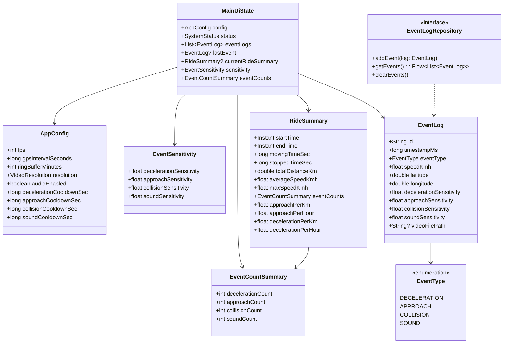

# ChariSafe Phase3 システムアーキテクチャ仕様書 (設計レビュー第2弾反映版)

本書は、自転車用セーフティレコーダー「ChariSafe」の MVP および Phase2 で実装されたシステム全体アーキテクチャ、コンポーネント設計、データフロー、およびストレージ構造を定義するものである。

本仕様書は、設計レビュー結果第2弾（MainUiStateへの直近イベント保持、常時表示エリアへのラストイベントカード追加、RideSummaryへの単位走行距離/時間あたりの危険度指標計算、EventLog詳細での全感度パラメータ表示、イベント件数サマリーカード化）を反映した最新設計を定義するものである。

---

## 1. システム全体設計 (MVVM + Clean Architecture)

ChariSafe は、長期のバックグラウンド稼働における安定性と省電力性を最優先に設計されており、明確な関心の分離（Separation of Concerns）に基づいたレイヤー構造を採用している。

```
[ UI Layer ] (Jetpack Compose / MainScreen & MainViewModel)
       ↕
[ Domain Layer ] (UseCases: SaveManualEventUseCase, Models: AppConfig, GpxPoint, etc.)
       ↕
[ Data Layer ] (Repositories, Foreground Service, Sensors, CameraX Pipeline)
```

---

## 2. クラス図 (Mermaid)



---

## 3. 状態遷移図 (Mermaid)

```mermaid
stateDiagram-v2
    [*] --> IDLE: アプリ起動 (停止中)
    
    state IDLE {
        [*] --> Configurable
        note right of Configurable: 録画設定・クールダウン秒数変更可能
    }

    IDLE --> RECORDING: 「録画スタート」押下
    
    state RECORDING {
        [*] --> BufferActive: リングバッファ常時録画
        BufferActive --> CheckCooldown: 自動イベント検知 (急減速/接近/衝突/大音量)
        
        state CheckCooldown {
            [*] --> CooldownCheck
            CooldownCheck --> FireEvent: クールダウン経過済み
            CooldownCheck --> Suppressed: クールダウン期間内 (発報抑制)
        }

        FireEvent --> ExportingAsync: 感度&LastEvent更新 & 退避 & バックグラウンド結合
        ExportingAsync --> BufferActive: 即時録画復帰
        Suppressed --> BufferActive: 抑制ログ出力後復帰

        note right of RECORDING
            - イベント感度スライダー変更可能
            - 速度メーター・経過時間更新
            - 「最後のイベント」リアルタイム表示
            - 走行データ蓄積
        end
    }

    RECORDING --> GeneratingSummary: 「録画ストップ」押下
    GeneratingSummary --> SummaryDisplayed: 危険度指標(件/km, 件/h)付きサマリー生成
    SummaryDisplayed --> IDLE: サマリー確認完了
```

---

## 4. イベントログ設計書 (EventLog)

### 4.1 正式データモデル定義 (`EventLog`)
イベント発生時の位置情報・速度・動画パスに加え、その時点の 4 つの感度設定値を完全に記録・保持する。

```kotlin
enum class EventType(val displayName: String, val emoji: String) {
    DECELERATION("急減速", "⚠"),
    APPROACH("接近検知", "🚗"),
    COLLISION("衝突・落下", "💥"),
    SOUND("大音量検知", "🔊")
}

data class EventLog(
    val id: String = UUID.randomUUID().toString(),
    val timestampMs: Long = System.currentTimeMillis(),

    val eventType: EventType,

    val speedKmh: Float,
    val latitude: Double,
    val longitude: Double,

    val decelerationSensitivity: Float,
    val approachSensitivity: Float,
    val collisionSensitivity: Float,
    val soundSensitivity: Float,

    val videoFilePath: String? = null
)
```

### 4.2 イベント発生時の `MainUiState.lastEvent` 更新仕様
イベントが発火した瞬間に、生成された `EventLog` が `MainUiState.lastEvent` へ即座に反映され、常時表示エリアの「最後のイベント」カードがリアルタイム更新される。

---

## 5. イベントクールダウン制御設計書

### 5.1 クールダウン要件とデフォルト設定 (`AppConfig`)
街中走行時の信号ストップや連続追越し等によるイベント通知・自動保存の連発を防止するため、`EventType` ごとに独立した発報抑制時間（クールダウン）を設ける。

| EventType | デフォルトクールダウン秒数 | 動作仕様 |
|---|---|---|
| **`DECELERATION` (急減速)** | **30 秒** | 発生から30秒以内の再検知は自動保存・警告音を抑制 |
| **`APPROACH` (接近検知)** | **60 秒** | 発生から60秒以内の再検知は自動保存・警告音を抑制 |
| **`COLLISION` (衝突・落下)** | **0 秒 (常時発報)** | 緊急性が極めて高いため、クールダウンなしで常時即時発報 |
| **`SOUND` (大音量検知)** | **30 秒** | 発生から30秒以内の再検知は自動保存・警告音を抑制 |

---

## 6. 速度グラフ ＆ マーカー設計書

### 6.1 データ構造と描画方式
- **X軸**: 経過時間（`00:00` 〜 録画経過時間）
- **Y軸**: 走行速度 ($0 \text{ km/h} \sim \text{最高速度} + 5 \text{ km/h}$)
- **データソース**: `LocationTracker` / `GpxRepository` が保持する `List<GpxPoint>`
- **イベントマーカー描画**:
  - 各 `EventLog` の `timestampMs` に該当する X軸位置の上にアイコン（マーカー）を重ねてプロット。
  - ⚠ （黄）: 急減速 | 🚗 （赤）: 接近検知 | 💥 （橙）: 衝突・落下 | 🔊 （紫）: 大音量

---

## 7. ライドサマリー＆危険度指標設計書

### 7.1 ライドサマリー指標集計 (`RideSummary`)
録画停止（「録画ストップ」）時に、走行中に蓄積された GPX ポイントデータおよびイベントログから集計。特に**ライド全体の危険度を定量化するため、単位距離あたり・時間あたりの発生レートを追加算出**する。

```kotlin
data class RideSummary(
    val startTime: Long,
    val endTime: Long,
    val movingTimeSec: Long,
    val stoppedTimeSec: Long,
    val totalDistanceKm: Double,
    val averageSpeedKmh: Float,
    val maxSpeedKmh: Float,
    val eventCounts: EventCountSummary,
    
    // 【必須追加3】危険度定量的指標
    val approachPerKm: Float,      // 接近検知 (件/km)
    val approachPerHour: Float,     // 接近検知 (件/h)
    val decelerationPerKm: Float,  // 急減速 (件/km)
    val decelerationPerHour: Float  // 急減速 (件/h)
)
```

### 7.2 危険度指標計算式
- $\text{approachPerKm} = \frac{\text{接近検知累積件数}}{\text{totalDistanceKm}}$
- $\text{approachPerHour} = \frac{\text{接近検知累積件数}}{\text{movingTimeSec} / 3600.0}$
- $\text{decelerationPerKm} = \frac{\text{急減速累積件数}}{\text{totalDistanceKm}}$
- $\text{decelerationPerHour} = \frac{\text{急減速累積件数}}{\text{movingTimeSec} / 3600.0}$

---

## 8. 位置共有機能設計

### 8.1 位置共有 Intent 仕様
現在地（最新の `GpxPoint`）から Google Maps URL を自動生成し、Android 標準共有シート (`Intent.ACTION_SEND`) を呼び出す。
- **URL形式**: `https://maps.google.com/?q={latitude},{longitude}`
